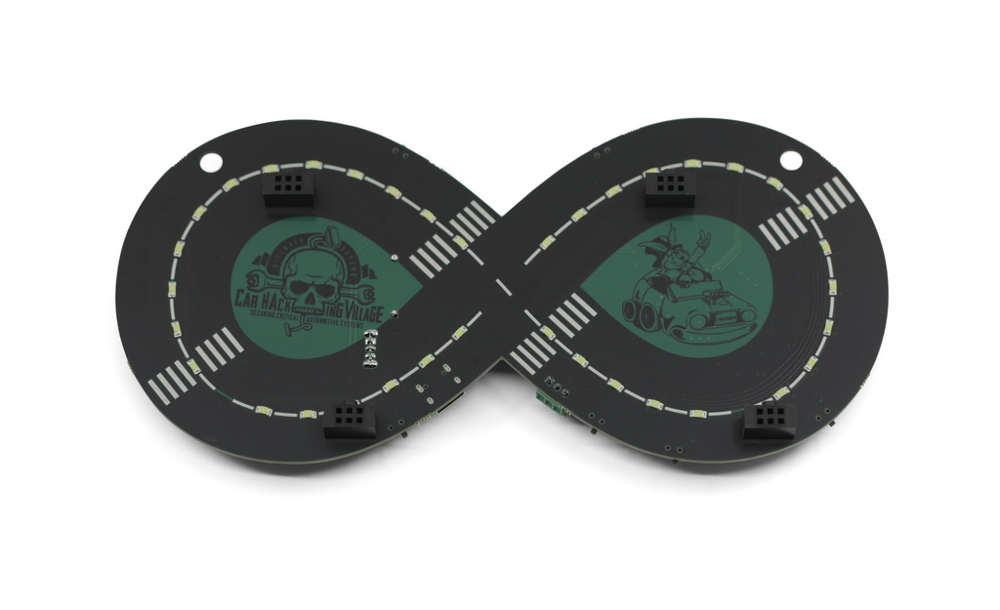
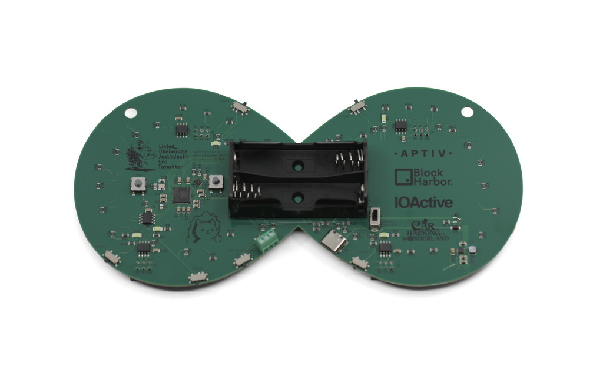
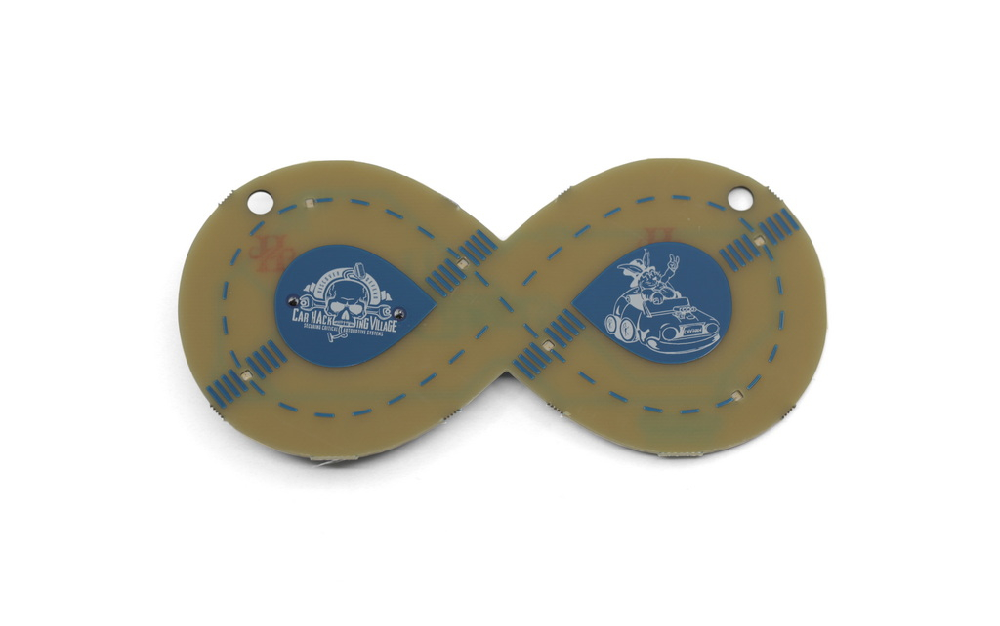
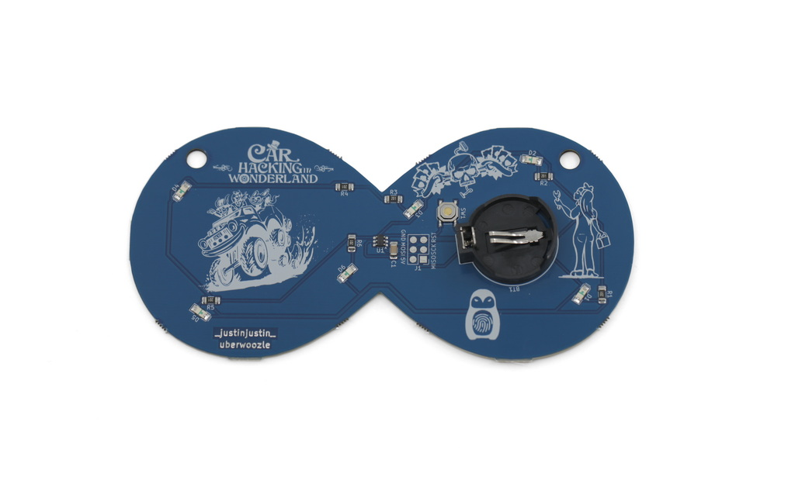

# 2024 Car Hacking Village Badge

*Event:* DEFCON 32

The badge was also available for purchase on [Hacker Warehouse](https://hackerwarehouse.com/product/car-hacking-village-2024-badge/)

## Firmware / SDK / Files

- *Badge PCB Repo:* [car-hacking-village/DC32_CHV_Badge_Board](https://github.com/car-hacking-village/DC32_CHV_Badge_Board)
- *Badge Firmware Repo:* [car-hacking-village/DC32_CHV_Badge_Firmware](https://github.com/car-hacking-village/DC32_CHV_Badge_Firmware)
- *Badge Speedometer Firmware Repo:* [car-hacking-village/DC32_CHV_Speedometer_Firmware](https://github.com/car-hacking-village/DC32_CHV_Speedometer_Firmware)

## Specifications

Description from Hacker Warehouse:

>Car Hacking Village badge from 2024. Powered by the rp2040, contains 4 CAN Networks, Dry CAN Connector, and 4 SAO Connectors. Also includes CTF Challenges.

## Variants

A miniature "Kids Badge" was also available at DEFCON 32, featuring a blue PCB. This was also available on [Hacker Warehouse](https://hackerwarehouse.com/product/car-hacking-village-2024-kids-badge/)

Description of Kids Badge from Hacker Warehouse:

>Contains a traffic light simulator and blinky lights!

## Photos

Kids Badge:

